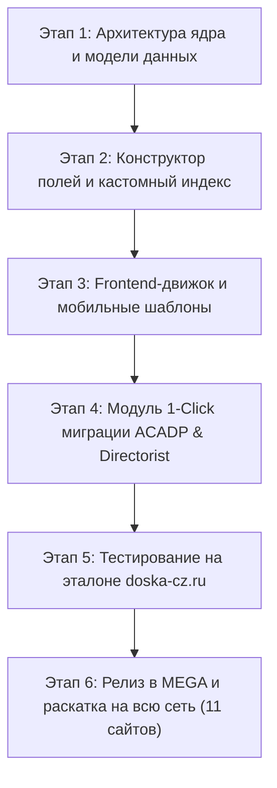

# Архитектурный план: Универсальный плагин доски объявлений и каталога фирм — WP Board & Directory (VladiMIR+AI✅)

**Автор:** Владимир Буланцев (`@GinCz`) & AI  
**Репозиторий:** [GinCz/WordPress](https://github.com/GinCz/WordPress)  
**Версия спецификации:** v1.0.0 (Мастер-план)  
**Целевой стек:** WordPress 6.0+, PHP 8.1–8.4, MariaDB/MySQL, тема Flatsome (UX Builder), Nginx/FastPanel  

---

## 🧭 1. МИССИЯ И ФИЛОСОФИЯ ПРОЕКТА

Существующие плагины досок и каталогов на рынке (Directorist, ACADP, GeoDirectory, WPAdverts, Classified Listing) страдают от трех системных пороков:
1. **Экстремальный оверхед и медлительность:** Загружают десятки тяжелых CSS/JS файлов, библиотеки React/jQuery, забивают `wp_options` и выполняют десятки неоптимизированных SQL-запросов (N+1 meta queries), что уничтожает мобильный TTFB и рейтинг Google PageSpeed.
2. **Агрессивная коммерциализация:** Базовые жизненно необходимые функции (произвольные поля, галерея, карта, мессенджеры, поиск, продление объявлений) заблокированы за дорогими годовыми подписками ($100–$300/год за аддоны).
3. **Устаревший и перегруженный UI:** Неудобные формы подачи объявлений на смартфонах, громоздкие таблицы и чужеродные стили, конфликтующие с UX Builder и Flatsome.

### 💎 Наша цель:
Создать **самый быстрый, компактный, удобный и функциональный плагин в мире**, объединяющий **Доску объявлений** (Classifieds) и **Каталог компаний/услуг** (Business Directory) в едином чистом ядре.
* **100% Бесплатно и Без рекламы:** Все функции, которые у конкурентов платные (VIP, автоподнятия, бейджи, мульти-поля, карты, часы работы, мессенджеры, статистика) — встроены в ядро из коробки.
* **Mobile-First & Ultra-Compact:** Подача объявления со смартфона за 60 секунд. Легковесный чистый адаптивный интерфейс.
* **Производительность уровня Bazos / Sbazar:** Чистый Vanilla JS (< 25 KB), CSS-переменные (наследование цветов темы Flatsome), мгновенный AJAX-поиск с фильтрами без перезагрузки страниц.
* **Бесшовная миграция 1-Click:** Автоматический перенос всех 297+ объявлений из ACADP и всех компаний из Directorist без потери ссылок, SEO-позиций и фото.

---

## 🔍 2. АНАЛИЗ КОНКУРЕНТОВ И ЛУЧШИЕ ПРАКТИКИ

| Параметр | **Directorist** | **ACADP** | **Bazos.cz / Sbazar** | **Наш WP Board & Directory (VladiMIR+AI)** |
|---|---|---|---|---|
| **Размер плагина** | ~42 MB (Монстр) | ~9 MB | N/A (Собственный движок) | **< 1.5 MB (Микро-ядро)** |
| **JS / CSS оверхед** | 35+ скриптов, React, FontAwesome | Bootstrap 4, устаревший jQuery | Ультра-минималистичный | **1 Vanilla JS (<25KB) + 1 CSS (<20KB), 0 jQuery** |
| **Интеграция каталога компаний и частных объявлений** | Только каталог (объявления через хаки) | Только объявления (каталог костылями) | Разделение рубрик | **Единый движок с гибридными режимами (Объявление / Компания)** |
| **Платные опции** | Аддоны $199/год | Pro $49-$99 | Платные SMS-поднятия | **Все VIP/PRO фишки доступны бесплатно** |
| **Карты и геопозиция** | Платный аддон Google Maps (дорогие API-ключи) | Google Maps | OpenStreetMap (Чехия) | **Бесплатный Leaflet + OpenStreetMap (без API-ключей и оплат)** |
| **Связь с автором** | Стандартная email-форма | Email-форма | Телефон + форма | **Прямые кнопки 1-Click: Telegram, WhatsApp, Viber, Телефон** |
| **Сжатие фото** | На сервере (нагрузка на PHP/GD) | Оригиналы (забивают диск) | Сжатие до 1280px | **Клиентское сжатие в WebP в браузере перед отправкой (экономия 80% трафика и диска)** |

---

## 🏗️ 3. АРХИТЕКТУРА И ДАННЫЕ

### 3.1. Структура сущностей (Hybrid Data Model)
Плагин регистрирует два взаимодополняющих Custom Post Type (CPT) или единый масштабируемый CPT `vladimir_board` с типами записи (`listing_type`):
1. **`classified` (Частное объявление):**
   * Товар, услуга, недвижимость, авто, работа, животные, личные вещи.
   * Атрибуты: Цена, Валюта, Состояние (Новое/Б/У), Торг, Срочно, Бесплатно/Обмен, Город/Район, Контакты (Телефон, Telegram, WhatsApp, Viber).
2. **`company` (Профиль компании / Сервис / Фирма):**
   * Карточка организации, бренда, мастера или сервисного центра.
   * Атрибуты: Название бренда, Логотип, Режим работы (пн–вс, обед, открыто сейчас), Адрес/Офис на карте, Официальный сайт, IČO/ОГРН, Соцсети, Список филиалов, Каталог услуг/прайс-лист.

### 3.2. Таксономии (Taxonomies)
* **Категории (`board_cat`):** Древовидная структура (Родитель -> Подкатегория) с назначением уникальных иконок (SVG / Dashicons / Flatsome icons) и возможностью привязки динамических полей.
* **Локации (`board_loc`):** Города, регионы, районы (например, Прага, Брно, Острава, Пльзень, Среднечешский край...).
* **Типы сделки (`board_deal`):** Продам, Куплю, Сдам, Сниму, Услуга, Ищу работу, Предлагаю работу, Обмен, Отдам даром.

### 3.3. Таблицы базы данных (Оптимизация производительности)
Для исключения тяжелых `meta_query` с `JOIN wp_postmeta`, ключевые фильтруемые параметры кэшируются в быстрой компактной таблице индексов:
* **`wp_vladimir_board_index`:**
  * `listing_id` (BIGINT, PRIMARY KEY)
  * `listing_type` (ENUM: 'ad', 'company')
  * `category_id` (BIGINT, INDEX)
  * `location_id` (BIGINT, INDEX)
  * `price` (DECIMAL(12,2), INDEX)
  * `currency` (VARCHAR(5))
  * `is_featured` (TINYINT(1), INDEX)
  * `is_urgent` (TINYINT(1), INDEX)
  * `views_count` (INT DEFAULT 0)
  * `phone_reveals` (INT DEFAULT 0)
  * `expires_at` (DATETIME, INDEX)
* **Результат:** Любая выборка с фильтрами по городу, рубрике, цене и статусу VIP выполняется за **1–3 миллисекунды** одним прямым `SELECT ... FROM wp_vladimir_board_index`.

---

## 🎨 4. МОБИЛЬНЫЙ ИНТЕРФЕЙС И ДИЗАЙН-СИСТЕМА (MOBILE-FIRST)

### 4.1. Главная страница и каталог
* **Компактная шапка:** Быстрый поиск в 1 строку (что ищете?) + выпадающий список городов с автоопределением.
* **Сетка категорий:** Крупные, аккуратные touch-friendly плашки с иконками и счетчиками объявлений (адаптивная сетка: 2 колонки на телефоне, 4 на планшете, 6 на десктопе).
* **Карточки объявлений (Cards):**
  * Пропорция фото 4:3 с мягким скруглением и ленивой загрузкой (`loading="lazy"`).
  * Бейджи: `ТОП` (золотистый), `Срочно` (красный), `Компания` (синий бейдж верификации).
  * Цена крупным контрастным шрифтом с подсветкой «Торг» / «Бесплатно».
  * Город и дата публикации (формат: *«Сегодня в 14:20»* или *«Вчера»*).
  * Быстрая кнопка «В избранное» (сердечко с мгновенным сохранением в LocalStorage без обязательной авторизации).

### 4.2. Карточка детального просмотра (Single Listing Page)
* **Фотогалерея:** Легкий свайп-слайдер для смартфонов (чистый CSS Scroll Snap или 2 KB скрипт) с полноэкранным открытием по тапу.
* **Кнопки быстрой связи (Direct CTA Panel):**
  * Закрепленная снизу экрана на мобильных плашка (Sticky Bottom Bar):
    * 📞 Позвонить (по клику анти-спам скрывает часть номера до нажатия `Показать телефон` для защиты от парсеров).
    * 💬 Написать в WhatsApp (прямая ссылка `https://wa.me/...`).
    * ✈️ Написать в Telegram (`https://t.me/...`).
    * 🟣 Написать в Viber.
* **Карта проезда:** Легкая векторная картографическая подложка Leaflet/OpenStreetMap.
* **Похожие объявления:** Сетка релевантных предложений из той же рубрики и города.

### 4.3. Форма добавления объявления (Add Listing Flow — 60 секунд)
* Пошаговый мастер или компактный единый экран без лишних вопросов:
  1. Выбор: Частное объявление или Компания.
  2. Заголовок и выбор рубрики (с авто-подсказкой рубрики по ключевым словам).
  3. Перетаскивание фото прямо со смартфона (мульти-загрузка из галереи или камеры).
  4. Автоматическое сжатие фото на стороне клиента в формат WebP (макс. 1280px, качество 80%).
  5. Цена, контакты и локация.
  6. Мгновенная публикация с защитой через Cloudflare Turnstile.

---

## ⚡ 5. ПОЛНЫЙ НАБОР «PRO» ФУНКЦИЙ (ВСЕ ВКЛЮЧЕНО БЕСПЛАТНО)

1. **Конструктор произвольных полей (Custom Fields Builder):**
   * Привязка специфических полей к рубрикам: для Авто — марка, модель, пробег, коробка; для Недвижимости — этаж, площадь, комнатность; для Работы — график, зарплата.
   * Типы полей: число, текст, выбор из списка (Select), радио-кнопки, чекбоксы.
2. **Личный кабинет пользователя (User Dashboard):**
   * Мои объявления (активные, на модерации, архивные).
   * Редактирование в 1 клик, снятие с публикации («Продано»), удаление.
   * Статистика просмотров и кликов по телефону.
   * Кнопка «Поднять объявление» (обновляет дату публикации на текущую).
3. **Продвижение и VIP-статусы:**
   * Включение бейджей «VIP», «Выделенное», «Срочно» прямо из админки администратором или автоматическими правилами.
4. **Анти-спам и безопасность:**
   * Защита формы добавления через Cloudflare Turnstile без навязчивых капч.
   * Маскирование телефонов от поисковых роботов и спам-ботов.
   * Фильтрация стоп-слов и запрещенного контента в заголовках и описаниях.
5. **SEO-оптимизация и микроразметка Schema.org:**
   * Автоматическая генерация разметки `schema.org/Product`, `schema.org/LocalBusiness`, `schema.org/Offer`.
   * Полная интеграция с нашим авторским плагином `wp-seo-micro`.
   * Человекопонятные URL (ЧПУ) со slug категорий и транслитерацией через `translit-cyr-lat`.

---

## 🔄 6. БЕСШОВНЫЙ МОДУЛЬ 1-CLICK МИГРАЦИИ (ACADP & DIRECTORIST)

В плагин встраивается автономная утилита переноса:
* **Сканирование ACADP:** Автоматически находит все записи `acadp_listings`, термины рубрик, локации, прикрепленные фото (`_thumbnail_id`, gallery IDs) и мета-поля (цена, телефон, email).
* **Сканирование Directorist:** Находит все записи `at_biz_dir`, логотипы компаний, веб-сайты, часы работы и соцсети.
* **Трансформация и перенос:** Создает новые записи с полным сохранением оригинальных ID или настройкой 301 редиректов, исключая проседание поискового трафика в Яндексе и Google.
* **Безопасный откат:** Исходные таблицы ACADP и Directorist не удаляются до подтверждения успешности миграции.

---

## 🚀 7. ЭТАПЫ И ДОРОЖНАЯ КАРТА РАЗРАБОТКИ (ROADMAP)

### Детализация этапов:
1. **Этап 1: Ядро плагина (`wp-board-directory`)**
   * Регистрация CPT, базовых таксономий, прав пользователей и настроек.
   * Интеграция стандартных модулей Владимира: `vladimir-ai-updater.php`, `vladimir-ai-i18n.php`.
2. **Этап 2: Индексная таблица и REST API / AJAX обработчики**
   * Создание таблицы `wp_vladimir_board_index`.
   * Обработчики AJAX-поиска, фильтрации, пагинации и подсчета кликов.
3. **Этап 3: Мобильный UI и шорткоды для Flatsome**
   * Шорткоды: `[vladimir_board_listings]`, `[vladimir_board_categories]`, `[vladimir_board_search]`, `[vladimir_board_companies]`, `[vladimir_board_submit]`, `[vladimir_board_dashboard]`.
   * Поддержка элементов UX Builder (drag & drop в конструкторе).
4. **Этап 4: Модуль конвертера (Migration Wizard)**
   * Интерфейс в админке с прогресс-баром и журналом переноса объявлений.
5. **Этап 5: Пилотное внедрение на `doska-cz.ru`**
   * Полная проверка скорости, работы кнопок мессенджеров, удобства подачи объявлений со смартфона.
6. **Этап 6: Публикация в MEGA и тиражирование**
   * Сборка релизного архива `WP_Board-Directory_(VladiMIR+AI)_1.00.zip`.
   * Выгрузка в `D:\MEGA\WordPress\PLUGINS\` и раскатка на все 11 досок.

---

## 📄 Ссылка на документ в репозитории:
* План зафиксирован в GitHub: [`WP_BOARD_DIRECTORY_MASTER_PLAN.md`](https://github.com/GinCz/WordPress/blob/main/plugins/WP_BOARD_DIRECTORY_MASTER_PLAN.md)
